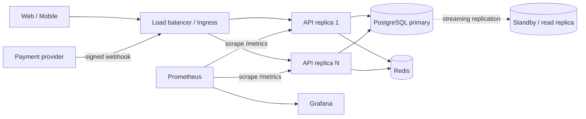
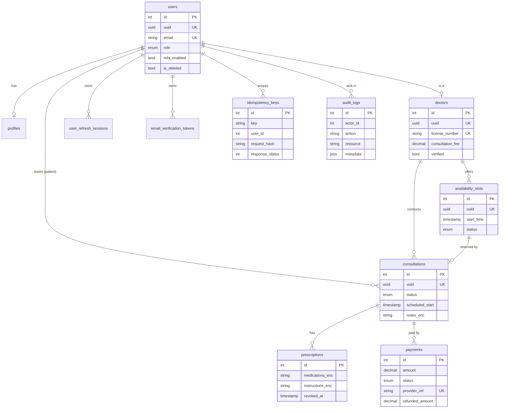

# Amrutam Telemedicine Backend: Architecture

Status legend used throughout: **[Implemented]** is in the repo and covered by the running system. **[Design]** is the documented target design, not yet in code.

## 1. Goals and sizing

| Requirement | How it is addressed |
|---|---|
| 100k consultations/day | ~1.2 req/s average; assume 10x peak, so ~12 booking writes/s and ~100 read req/s. A single Node instance handles this; we run N stateless replicas behind a load balancer for availability. |
| p95 < 200 ms reads, < 500 ms writes | Indexed queries, Redis cache on the hot read (free slots), single short transaction per write. Measured via `http_request_duration_seconds`. |
| 99.95% availability | ~4.4 h downtime/year budget. Stateless API replicas, managed Postgres with standby, Redis outage degrades to DB (cache and rate limiter fail open or closed as noted below). |
| Security | JWT + rotating refresh tokens, RBAC, field encryption, audit log, validation. See `security.md`. |

## 2. High-level architecture



The API is a **modular monolith** (Express 5 + TypeScript). Each module owns its routes, controller, service, repo, schema and constants, so any module can later be extracted into a service without changing its callers.

| Module | Responsibility |
|---|---|
| `auth` | register, login, refresh rotation, logout, change password, lockout |
| `users` | profile, admin user management, role changes |
| `doctors` | doctor profile, verification, search and filtering |
| `slots` | availability creation, block/unblock, cached free-slot listing |
| `consultations` | booking, cancel, reschedule, start, complete, encrypted notes |
| `prescriptions` | create, fetch, revoke (encrypted medications) |
| `payments` | intent, signed webhook, refund |
| `admin` | audit log query, analytics (overview, doctors, funnel) |

Layering inside a module: **routes → controller (parse with Zod, audit) → service (rules, authorization) → repo (all Prisma access, wrapped in `dbOperation`)**. Dependencies point inward only; repos are the only code that touches the database.

## 3. Data flow: booking a consultation

```mermaid
sequenceDiagram
    autonumber
    participant P as Patient
    participant API as API
    participant IDEM as Idempotency middleware
    participant DB as PostgreSQL
    participant R as Redis
    participant PSP as Payment provider

    P->>API: POST /v1/consultations {slot_uuid} + Idempotency-Key
    API->>IDEM: authenticate, then claim key
    IDEM->>DB: INSERT idempotency_keys (user_id, key)
    alt key already completed with same request hash
        IDEM-->>P: replay stored response (Idempotent-Replay: true)
    else new key
        API->>DB: BEGIN
        API->>DB: UPDATE slot SET BOOKED WHERE uuid AND status=AVAILABLE AND doctor.verified
        alt 0 rows (taken)
            API-->>P: 409 Slot is not available
        else 1 row
            API->>DB: INSERT consultation (PENDING_PAYMENT)
            API->>DB: COMMIT
            API->>R: bump slots:ver:{doctor} (invalidate cache)
            API-->>P: 201 consultation
        end
    end
    P->>API: POST /v1/payments/intent {consultation_uuid}
    API->>DB: INSERT payment (PENDING, provider_ref)
    API-->>P: payment intent
    PSP->>API: POST /v1/payments/webhook (X-Signature HMAC-SHA256)
    API->>DB: BEGIN; payment PENDING to SUCCEEDED; consultation PENDING_PAYMENT to CONFIRMED; COMMIT
    API-->>PSP: 200
```

## 4. ER diagram



Key constraints **[Implemented]**:

- `availability_slots`: `UNIQUE(doctor_id, start_time)`, index `(doctor_id, status, start_time)`.
- `consultations`: partial unique index `ON (slot_id) WHERE status <> 'CANCELLED'`, a database-level guarantee that a slot never has two live consultations.
- `payments`: partial unique index `ON (consultation_id) WHERE status IN ('PENDING','SUCCEEDED')`, at most one live payment per consultation.
- `prescriptions`: partial unique index `ON (consultation_id) WHERE revoked_at IS NULL`.
- `idempotency_keys`: `UNIQUE(user_id, key)`.

## 5. API schema

The full contract is in `docs/swagger.yaml` (OpenAPI 3). Live docs are served at `/api-docs` outside production. Resource summary:

| Area | Routes |
|---|---|
| Auth | `POST /auth/register, /login, /refresh-token, /logout, /logout-all, /change-password` |
| Users | `GET/PATCH /users/me`; admin: `GET /users`, `GET/DELETE /users/:uuid`, `PATCH /users/:uuid/role` |
| Doctors | `GET /doctors` (search/filter), `POST /doctors`, `GET/PATCH /doctors/:uuid`, `PATCH /doctors/:uuid/verify` |
| Slots | `POST/GET /doctors/:uuid/slots`, `PATCH/DELETE /slots/:uuid` |
| Consultations | `POST /consultations`, `GET /consultations[/:uuid]`, `PATCH /:uuid/cancel, /reschedule, /start, /complete`, `PUT /:uuid/notes` |
| Prescriptions | `POST/GET /consultations/:uuid/prescription`, `GET /prescriptions/:uuid`, `PATCH /prescriptions/:uuid/revoke` |
| Payments | `POST /payments/intent`, `POST /payments/webhook`, `GET /payments[/:uuid]`, `POST /payments/:uuid/refund` |
| Admin | `GET /admin/audit-logs`, `GET /admin/analytics/overview, /doctors, /funnel` |
| Ops | `GET /health`, `/health/live`, `/health/ready`, `/metrics` |

Conventions: all routes under `/v1`; success envelope `{success, message, data}`; error envelope `{success:false, message, error, request_id}`; list endpoints paginate with `page`/`limit` (max 50 to 100); every write that creates or moves money or time requires `Idempotency-Key`.

## 6. Concurrency and double-booking prevention **[Implemented]**

Two independent layers:

1. **Atomic conditional update.** Booking runs `UPDATE availability_slots SET status='BOOKED' WHERE uuid=? AND status='AVAILABLE' AND start_time > now() AND doctor.verified`. Postgres serialises concurrent updates on the same row, so exactly one transaction sees `count = 1`; the others see `0` and return 409. No explicit lock, no read-then-write gap.
2. **Database invariant.** The partial unique index on `consultations(slot_id) WHERE status <> 'CANCELLED'` rejects a second live consultation even if application logic were bypassed.

Slot status changes by doctors use the same pattern (`WHERE status <> 'BOOKED'`), so a doctor cannot block or delete a slot in the instant it is booked. Cancel and reschedule use compare-and-set updates guarded by the expected status. This is verified by the integration test `tests/integration/booking.test.ts` (two patients, one slot: exactly one 201 and one 409, one consultation row).

## 7. Idempotency **[Implemented]**

`Idempotency-Key` (8 to 128 chars) is mandatory on booking, payment intent, refund and prescription creation.

- First request inserts `(user_id, key, sha256(method+url+body))`. The unique constraint makes the claim atomic, so two simultaneous requests with the same key cannot both proceed.
- Same key, same hash, completed: the stored status and body are replayed with `Idempotent-Replay: true`.
- Same key, same hash, still running (< 60 s): 409 "in progress". Older than 60 s with no response: treated as a crashed request and re-claimed.
- Same key, different hash: 422.
- Only 2xx responses are stored; failures delete the key so the client can retry with the same key.
- Rows expire after 24 h.

The payment webhook is idempotent by state, not by key: transitions use `WHERE status='PENDING'`, so a replayed webhook returns `IGNORED` and changes nothing.

## 8. Transactions and sagas

**Local transactions [Implemented].** Booking (slot claim + consultation insert), cancel (consultation update + slot release), reschedule (claim new slot + move + release old), refresh-token rotation, and webhook application are each a single database transaction.

**Booking-payment saga (orchestrated by state machine) [Implemented].**

| Step | Action | Compensation |
|---|---|---|
| 1 | Book: slot BOOKED, consultation `PENDING_PAYMENT` | Cancel releases the slot |
| 2 | Payment intent: payment `PENDING` | `payment.failed` webhook sets `FAILED`; patient can create a new intent |
| 3 | `payment.succeeded` webhook: payment `SUCCEEDED` + consultation `CONFIRMED` in one transaction | If the consultation is no longer `PENDING_PAYMENT` (cancelled meanwhile), the payment is auto-marked `REFUNDED` in the same transaction (`AUTO_REFUNDED`) |

Refunds are atomic in SQL (`refunded_amount + x <= amount` in the `WHERE`), so concurrent refunds can never exceed the paid amount.

**Gaps [Design].** (a) Unpaid bookings currently hold a slot until cancelled; a scheduled job should expire `PENDING_PAYMENT` consultations after ~15 min and release the slot. (b) Cancelling a paid `CONFIRMED` consultation does not trigger a refund automatically; an admin issues it through the refund API. (c) Provider-side refund calls are simulated; with a real PSP they move to an async worker using the transactional-outbox pattern: write an `outbox` row in the same transaction, a worker publishes it.

## 9. Retry and backoff

- **Client to API [Implemented].** Safe retries are guaranteed by `Idempotency-Key`. Recommended client policy: retry on network errors, 429 and 5xx only, exponential backoff `delay = min(30s, 500ms * 2^attempt) * random(0.5, 1.5)` (full jitter), max 5 attempts, same key every time. Respect `Retry-After`/`RateLimit-*` headers on 429.
- **Provider to API [Implemented].** Payment providers retry webhooks on non-2xx; our handler is idempotent so retries are harmless.
- **API to external systems [Design].** Email and payment-provider calls run in a background worker with the same backoff (1 s, 2 s, 4 s, 8 s, 16 s, plus jitter), then a dead-letter queue and an alert. Today email sending is best-effort and never fails a request.
- **Postgres [Design].** Retry serialization and deadlock errors (`40001`, `40P01`) up to 3 times with 50 to 200 ms jittered backoff. The current writes avoid long-held locks, so these are rare.

## 10. Caching **[Implemented]**

| What | Key | TTL | Invalidation |
|---|---|---|---|
| Free slots per doctor and date range | `slots:{doctorUuid}:{version}:{from}:{to}` | 60 s | **Version bump:** every slot write (create, block, delete, book, cancel, reschedule) does `INCR slots:ver:{doctorUuid}`, orphaning every old key at once. No key scanning or fan-out deletes. |
| Admin analytics | `analytics:*:{from}:{to}` | 60 s | TTL only (staleness of 1 min is acceptable for dashboards) |

Redis is a pure optimisation: all cache calls swallow errors and fall back to the database, so a Redis outage costs latency, not correctness. Slot data is never trusted from cache for writes; booking always goes through the conditional `UPDATE`. Cache stampede on a hot doctor is bounded by the 60 s TTL and cheap indexed query.

## 11. Data partitioning and scale-out **[Design]**

Not needed at 100k/day (about 36M consultations/year, which Postgres handles comfortably with the existing indexes), but the plan is:

- **`audit_logs` and `consultations`**: declarative range partitioning by month on `created_at`; detach and archive partitions older than the retention window (audit: 7 years to object storage); indexes are per-partition and stay small.
- **`idempotency_keys`**: daily partitions or a nightly `DELETE WHERE expires_at < now()` (cheap with an index on `expires_at`).
- **Reads**: route analytics and listing queries to a streaming replica; writes stay on the primary.
- **Beyond one primary**: shard by `doctor_id` (a booking touches one doctor's slots, so it stays single-shard). Patient-centric lists fan out by `patient_id` through a lookup index.
- **API tier**: stateless, scales horizontally; rate limiting moves from per-process memory to Redis so limits are global **[Design]**.

## 12. Observability

- **Metrics [Implemented].** `/metrics` (Prometheus): default Node/process metrics, `http_request_duration_seconds` histogram (buckets chosen around the 200/500 ms SLOs) and `http_requests_total`, both labelled by method, route template and status (route templates, not raw URLs, so cardinality stays bounded). Prometheus and Grafana run in `docker-compose.yml`.
- **Suggested alerts.** p95 latency per route group, 5xx ratio > 1% for 5 min, `/health/ready` failing, booking 409 spike.
- **Logs [Implemented].** Structured JSON (Winston) with an `x-request-id` correlation id echoed in error responses and recorded in `audit_logs.request_id`.
- **Health [Implemented].** `/health/live` (process up) and `/health/ready` (database and Redis reachable, 2 s timeout) for Kubernetes probes.
- **Tracing [Design].** OpenTelemetry SDK exporting OTLP (`OTEL_EXPORTER_OTLP_ENDPOINT` is already a config key) with HTTP, Prisma and Redis instrumentation.

## 13. Backup and disaster recovery **[Design, standard managed-Postgres setup]**

| Item | Target |
|---|---|
| RPO | ≤ 5 min (continuous WAL archiving, point-in-time recovery) |
| RTO | ≤ 30 min for instance failure via automatic standby promotion; ≤ 4 h for regional loss via restore into the DR region |
| Backups | Daily full snapshot + WAL archive, 35-day retention, encrypted at rest, copied cross-region |
| Restore drills | Monthly restore into a scratch environment, verified by running the booking integration test |
| Redis | Treated as disposable (cache + rate limits); `appendonly yes` is enabled locally only to survive restarts |
| Secrets and keys | `ENCRYPTION_KEY` and previous keys live in the secret manager, backed up separately from the database; losing them makes encrypted columns unrecoverable, so key custody is part of the DR runbook |
| Multi-AZ | API replicas spread across at least two zones; Postgres primary + synchronous standby in a second zone |

## 14. Known limitations

- MFA (TOTP) is not enabled yet. The schema (`mfa_enabled`, `mfa_secret_enc`) and the login challenge branch are in place, but the setup/enable/verify routes are not.
- Unpaid bookings do not auto-expire yet (section 8).
- Access tokens remain valid for up to 15 minutes after logout (stateless JWT); refresh tokens are revoked immediately.
- Rate limiting is per process (in-memory) until moved to Redis.
- Prescription PDF generation and async jobs are not implemented.
- Dev-dependency and Prisma CLI audit findings are documented in `security.md`.